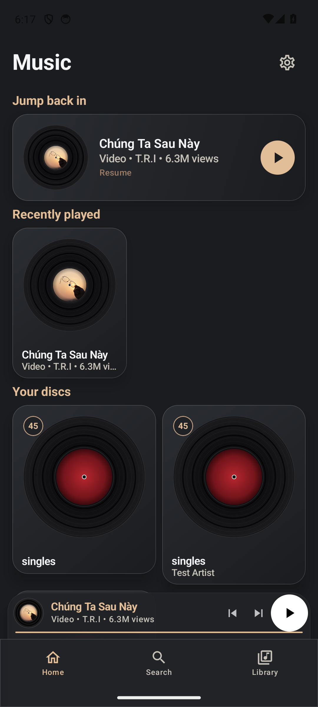
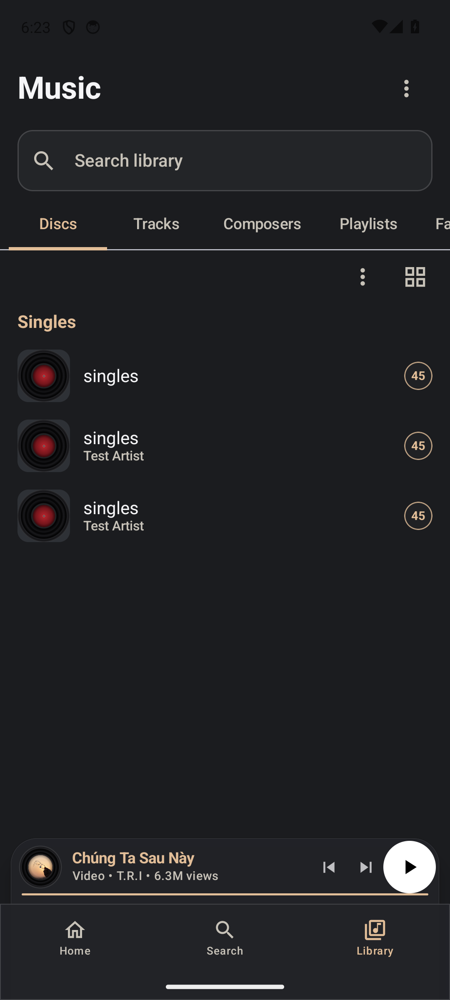
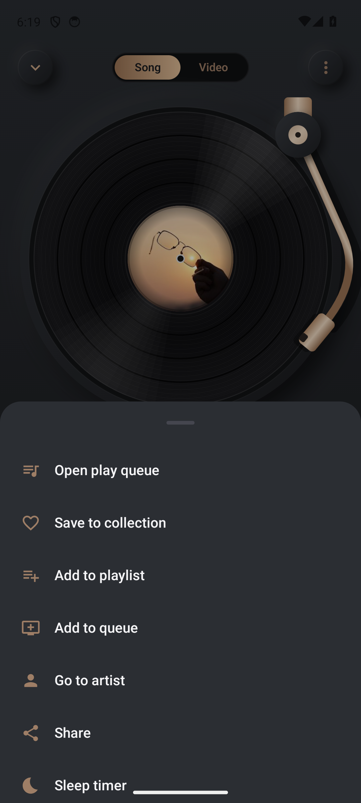
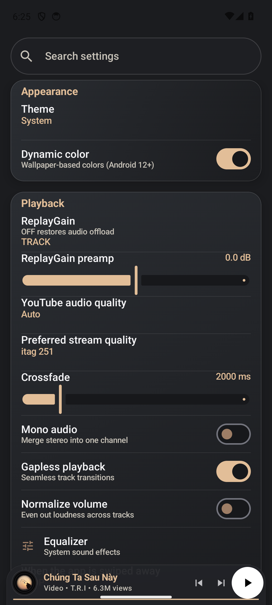

# Music — a local-first vinyl player for Android

**Music** (package `com.pianostream`) is a local-first music player: it scans your own
FLAC+CUE collection *and* streams audio & video from YouTube — with no accounts,
no backend, and no tracking. The whole app is a turntable: charcoal surface,
champagne-gold tonearm, vinyl records everywhere artwork is missing.

<p>
  
  
  
  
</p>


---

## Features

**Local library**
- One-tap folder import via SAF (Storage Access Framework) — no media permission needed
- A "disc" = a folder containing a `.cue` sheet + sibling `.flac` image: full
  cue parsing (performer/composer per track, INDEX times), gapless track slicing
- Loose audio files (mp3/m4a/aac/wav/ogg/opus/wma, cue-less flac) become
  **singles** — one-track discs badged `45`, tags & embedded art via
  MediaMetadataRetriever
- Incremental rescan by fingerprint — cover art dropped in later is picked up
- Discs / Tracks / Composers / Playlists / Favorites tabs, find-in-library,
  sorting, grid & list layouts, long-press action sheets

**YouTube**
- Search YouTube Music by name or paste any `youtube.com` / `youtu.be` link
  (videos and playlists)
- Audio streaming via a NewPipe-style InnerTube stack — mobile clients first
  (ANDROID_VR → VISIONOS → iOS → ANDROID), WEB_REMIX + real poToken
  (BotGuard attestation) as fallback
- Stream-quality selection: Low / Normal / High / Auto audio itags,
  144p–1080p video (adaptive DASH merged with audio via `MergingMediaSource`)
- Song ⇄ Video toggle in the player; landscape fullscreen with auto-hiding
  chrome and picture-in-picture
- **Offline downloads** — save YouTube audio to device storage, plays with
  zero network

**Playback**
- Media3/ExoPlayer + MediaSession (notifications, Bluetooth, lock screen)
- Persistent queue — survives process death, reorders, and item removal
- Sleep timer (5–60 min or end-of-track), share sheet, per-track action sheets
- Crossfade, gapless, mono downmix, normalize volume, ReplayGain preamp,
  system-equalizer link
- Synced lyrics — reads sibling `.lrc` files and falls back to LRClib, with
  tap-to-seek
- Recently-played rail, favorites collection, user playlists

**Design**
- Neumorphic vinyl language: `#1B1C1F` charcoal, `#E2BE98` champagne gold,
  spun-vinyl placeholders, skeuomorphic tonearm & transport
- Every text color is pinned to the Aurora token set — Material You dynamic
  color is supported but never darkens text on the dark surface

## Architecture

Multi-module Gradle build; dependencies point inward (`feature/* → core/*`,
`app` composes everything):

```
┌────────────────────────────── app ──────────────────────────────┐
│  navigation (AppNav routes) · scaffold (bottom nav + player)    │
│  AppViewModel (queue, favorites, playlists, pending hand-offs)  │
└───────────────┬──────────────────────────────┬─────────────────┘
                │                              │
   feature/home  feature/library   feature/search   feature/player
   (rails)      (discs, singles,   (YouTube Music   (turntable, queue,
                playlists,        + local, chips,  lyrics, sleep timer,
                artist pages)     recents)         video chrome, PiP)
                │                              │
                └───────────────┬──────────────┘
                       core/*
        ┌──────────┬──────────┬──────────┬──────────┐
     designsystem  local     data      media     youtube
     (theme,      (SAF,      (Room:    (player   (InnerTube
      vinyl art,  cue parse, queue,    factory,   clients, poToken,
      TrackRow…)  scanner)   playlists, data       resolver,
                            history,   sources,    cipher, search)
                            settings)  audio fx,
                                       lyrics)
```

| Module | Responsibility |
|---|---|
| `core:designsystem` | Aurora theme, vinyl art pipeline, shared rows/cards/sheets |
| `core:local` | SAF folder intake, `.cue` parser, incremental scanner, singles detection |
| `core:data` | Room DBs (library index, playback: queue/favorites/history/playlists/downloads), settings DataStore, `PianoStreamUri` scheme |
| `core:media` | `PlayerFactory` (ExoPlayer + sinks), queue controller, `StreamResolvingDataSource`, audio-fx processors (mono/normalize/gapless), lyrics repository |
| `core:youtube` | InnerTube clients & models, `StreamResolver` (format pick, cipher, poToken), search, video quality ladder |

### Key flows

**Library scan** — `DocumentFile` tree walk → disc = `.cue` + `.flac` siblings,
else loose audio → singles → fingerprint (size+mtime+art) → diff against Room
index → artwork via embedded tag or `cover.*`/`front.*` sibling → UI observes.

**YouTube playback** — `pianostream://stream/<id>` → `StreamResolvingDataSource`
asks `StreamResolver` → InnerTube `player` call per client (real `visitorData`
from `/visitor_id`, `X-Goog-Api-Format-Version: 2`, full client context) →
format pick by `audioItagProvider` / video ladder → cipher solve via player.js
→ stream (with `&pot=` when poToken-bound) → ExoPlayer.

**Offline downloads** — same resolve path, then stream-to-disk under
`filesDir/downloads/`; a `localFileProvider` on the data-source factory serves
the file and skips the network entirely, so downloads play in airplane mode.

**Queue** — single source of truth in Room (`playback.db`); `QueueItem` rows
with `position` + `mediaId`; app session restores cursor on cold start.

## Build

Requires JDK 17+, Android SDK 36/37, Gradle wrapper included.

```bash
# variants = dist{github, foss} × source{real, stub} × {debug, release}
./gradlew :app:assembleGithubRealDebug      # the build we ship
./gradlew :app:assembleFossRealDebug        # no updater surface
./gradlew :app:assembleGithubStubDebug      # fake player/repo — UI work, no network
```

- `github` vs `foss`: whether the self-update surface (release-asset download +
  minisign verification, Phase 5b) is compiled in
- `real` vs `stub`: real Media3/InnerTube stack vs in-memory fakes — the stub
  flavor runs the whole UI on an emulator with zero network or corpus
- Release builds sign with `release.jks` when `keystore.properties` exists at
  the repo root (git-ignored); otherwise they build unsigned

## Testing

```bash
./gradlew :core:data:testDebugUnitTest :core:local:testDebugUnitTest \
          :core:youtube:testDebugUnitTest :core:media:testDebugUnitTest
./gradlew :app:compileGithubStubDebugAndroidTestKotlin   # E2E suite
```

JVM unit tests cover the cue parser, scanner fingerprinting, resolver fallbacks,
poToken plumbing, queue math and stores; Robolectric where Android types leak in
(`android.util.Log` is wrapped so tests don't need it mocked). `androidTest`
holds UI E2Es on the stub flavor — cold-start scan, hostile input, queue
reorder/resume, and a stub-UI suite driving the real composables.

## Project layout

```
app/            entry point, nav graph, settings/about/updater, E2E tests
  src/github/   updater opt-in surface        src/foss/   stubbed-out variant
  src/real/     real wiring                   src/stub/   fakes (FakePlayer…)
core/           designsystem · local · data · media · youtube
feature/        home · library · search · player
docs/           progress-log.md · e2e/ · screenshots/
```

## Design system

`core:designsystem` owns the tokens — `Aurora.Bg #1B1C1F`,
`Vinyl.Gold #E2BE98`, `Vinyl.GoldDim`, `TextPrimary #F5F5F7`,
`TextSecondary #C7C2B8` — plus the spun-vinyl bitmap generator used for every
missing cover. Components (`TrackRow`, `DiscCard`, `*ActionsSheet`, sleep-timer
and add-to-playlist sheets) are shared across features so screens stay thin.

## Privacy

Everything lives on the device. The only network calls are to Google/YouTube
endpoints you trigger (search, stream resolve, LRClib lyrics) — and the
**This device only** switch in Settings cuts even those. No analytics, no ads,
no accounts.

## Status & limitations

- Updater opt-in flow (Phase 5b) is scaffolded but not yet wired
- `.cue` support targets FLAC disc images; other cue/audio pairings may need work
- Licensed YouTube tracks can still hit `LOGIN_REQUIRED` from flagged IPs —
  the poToken path covers most cases, music videos included

## License

Source-available for personal use — see repository owner for terms.
